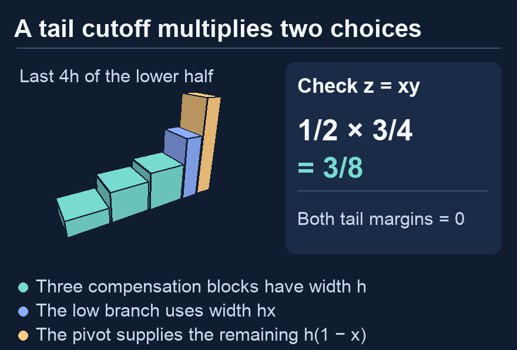

# The complexity of lower-tail risk constraints for long-run mean payoff

   

Simultaneous expectation and lower-tail CVaR constraints on coordinatewise liminf mean payoff in finite rational Markov decision processes are ∃ℝ-complete. Pure CVaR remains complete at any fixed rational interior tail level with binary state rewards. NP suffices exactly if NP = ∃ℝ.

[Read the paper](paper/manuscript.pdf) · [LaTeX source](paper/manuscript.tex) · [Original complexity question](https://arxiv.org/html/1805.02946v1#S6.SS3) · [Catalog Q668](https://github.com/10m-u/open-problems-catalog/blob/ca8d4d44ba3db527f19f28928c240168f545ecfe/problems/mathematics/optimization-operations-research.md#q668) · [Version DOI](https://doi.org/10.5281/zenodo.24572376)

## Explore the proof in 3D

The last four mass units of the lower half include three compensation blocks, a low branch segment of width hx and a pivot segment of width h(1−x). The shifted pivot payoff is 7 ± y. The product of its width and height yields the bilinear term. At x = 1/2 and y = 3/4, both tail thresholds hold exactly at z = 3/8. In the explorer, setting z = 1/2 makes the negative-sign constraint fail by 1/192.

[Download the offline explorer](https://raw.githubusercontent.com/DannyExperiments/mean-payoff-cvar-real-completeness/v1.0.0/visualization/tail-multiplication-explorer.zip) · [Explorer source](visualization/index.html) · [GIF rendering source](visualization/render.py)

## Why the proof works

Křetínský and Meggendorfer established NP-hardness and the prior real-algebraic membership method. The matching reduction uses opposed expectation constraints to synchronize a variable's limiting frequencies across branches. Conditional averaging improves every lower-tail bound, so the risk coordinates test the product on the branch means. The pure-CVaR companion pads the outcome law to move all thresholds to one level, then encodes each bounded reward vector by three-step binary emissions. The whole long-run payoff law survives up to scale, including for adaptive policies.

[Source comparison](audits/public_safe_reports/LITERATURE.md) · [Binary-reward companion](proof/binary-reward-companion.md)

## Reproduce the checks

    python3 -I scripts/verify_repository.py
    python3 -I verification/src/replay.py

The [recorded replay](verification/results/replay.txt) checks the multiplication table, common-level padding, binary emission marginals and the hinge identity by rational arithmetic. See [scope](CLAIM_SCOPE_AND_LIMITATIONS.md), [reproducibility](REPRODUCIBILITY.md), and the [research disclosure](AI_DISCLOSURE.md).

## Cite

DannyExperiments. *The complexity of lower-tail risk constraints for long-run mean payoff*. Version 1.0.0, 27 November 2026. [Version DOI](https://doi.org/10.5281/zenodo.24572376).

## Lean verification

Lean checks the mass drawn from the pivot and proves that the two signed lower-tail integral bounds for the compressed branches are simultaneously met exactly when z equals x times y, at positive branch weight. The correspondence with stochastic strategies, membership and binary-reward reduction remain in the paper. [Source and replay](formalization/README.md)
